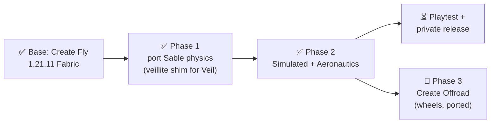

# minecraft-create-fly progress

_Last updated: 2026-10-28_

Port of Create Aeronautics to Minecraft 1.21.11 Fabric, on top of Create Fly 1.21.11-6.0.9-5. Task table in `ROADMAP.md`, porting rules in `PORTING.md`.

## Now
- Phase 1 code complete (all ROADMAP S rows done, incl. Sodium water occlusion + shadows). Open: hands-on checks by a person (walk/jump on moving sub-levels, camera feel, multiplayer) via `tools/e2e.sh play`.
- Phase 2 is merged into integration (p2-port fast-forwarded with integration). Per-area notes in `docs/p2-notes/`.
- 2026-10-28: Phase 3: Create Offroad ported as `offroad/` (branch `offroad-port`, not merged or released). Compiles; loads with all mixins applied; server-class/remap safety pass; resources valid. GameTests `OffroadWheelTest`: tires hold a car ~1 block up (bounce <0.01), no-tire control rests on the floor, 4WD car drives straight. Client scene `tools/e2e.sh client offroad` renders mounts, tires (OBJ via Create Fly's loader), borehead, rock cutter. Open: borehead bearing mining not tested in game; hands-on driving.
- 2026-10-28: Offroad on a copy of the server world (2026-10-25 tar, real 47-jar server modpack, release jars sable port.3 + offroad port.1): loads with no errors; a tired car stands ~1 block up on its tires; a mass-balanced 4WD car drives straight at ~10 blocks/s (a car with both motors on one side curves toward the heavy side: load-dependent wheel drag, upstream physics). Note: wheel mounts placed by /setblock with NBT but no ScrollValue get suspension strength 0 (sits on its hull); player-placed mounts default to 10. Merged to main.

## Next
- Hands-on playtest of Simulated + Aeronautics (`tools/e2e.sh play`, `tools/e2e.sh flight`), then a private release build.

## Done
- 2026-10-14: `:sable` compiles, server + client e2e pass, sub-levels render on 1.21.11.
- 2026-10-15: S9a closed as not a bug (the sphere lands before the first screenshot); `tools/e2e.sh` now exits non-zero when Gradle fails instead of reporting the previous run's log.
- 2026-10-17: S8a fixed: the server e2e force-loads the spawn area and logs loaded/moved sub-level counts (38/38 through 600 ticks).
- 2026-10-17: S14 fixed: Indigo path now re-shades rotated sub-levels (`getShade` neutral + up normal on shade-less quads); verified with a flipped platform, shading on vs off.
- 2026-10-17: S12 merged: Create Fly Flywheel visuals on sub-levels follow the sub-level pose (`tools/e2e.sh client flywheel`); lighting is S12a.
- 2026-10-17: S10 merged: `tools/e2e.sh playtest` checks assemble, fall/rest, stacking, standing on, carried by push/rotate/translate: 14/14 pass on integration.
- 2026-10-17: S17 merged: compat mixin review; fixed Shoulder Surfing descriptor (crashed on launch), `-Pe2eCompat` loads Shoulder Surfing + Jade; mods without a 1.21.11 Fabric build left out.
- 2026-10-17: S13 done: sub-levels darken the world sky light below them (shadow map pass + shadowed terrain pipelines, on by default); `tools/e2e.sh client shadows`.
- 2026-10-17: Phase 2 ported and merged into integration: Simulated + Aeronautics compile; server/client e2e pass with Create Fly, 22/22 GameTests, playtest 14/14, client `flight` scene flies an assembled airship. Sable fix on the way: players are carried across sub-level teleports (the S10 "carried by translate" check was racing the client's position reminder).

- 2026-10-17: S16 merged: ImGui inspector (bundled imguimc, `/sableinspector`, `tools/e2e.sh client inspector`). S11 merged: sub-levels render under Sodium 0.8 (`E2E_SODIUM=1`). S13 merged: sub-levels cast sky-light shadows (`tools/e2e.sh client shadows`). Full suite on integration: server 38/38, gametest 22 + 1 optional fail (gravity), playtest, flight (y=121), shadows, Sodium client all pass.
- 2026-10-17: S6 water occlusion verified (fixed a render-pass crash), S15 near-plane fixed with GL_DEPTH_CLAMP, S3 verified (`tools/e2e.sh client water`). S11 follow-ups: Flywheel visuals and S14 shading work under Sodium, Sodium skips plot sections, shadow pass is off under Sodium.
- 2026-10-17: Sodium water occlusion + sky-light shadows (patched Sodium chunk shaders). Full suite with and without Sodium passes (server, gametest 22+1 optional, playtest, flight, water, shadows, client).
- 2026-10-17: release jars verified in a real Fabric 1.21.11 install (server: 53 mods, 38 sub-levels simulate; offline client joins and renders). Fixed Sable UDP on macOS clients (EISCONN). Zip: `~/Documents/Projects/minecraft-create-fly-release/create-aeronautics-1.21.11-fabric.zip` (3 jars + INSTALL.txt; Fabric API 0.141.6+1.21.11 and Create Fly 1.21.11-6.0.9-5 installed separately).
- 2026-10-18: release `create-aeronautics-1.21.11-fabric-2026-10-18.zip` (integration 10860dd): adds the teammate's Lithium dedicated-server crash fix (propeller bearing `LangBuilder` → `Component`).
- 2026-10-18: Lithium crash reproduced and confirmed fixed on a real server; new required GameTest `server_class_safety` reflects over 114 mod classes like Lithium (no other offenders). Modrinth files ready in `~/Documents/Projects/minecraft-create-fly-release/` (`modrinth-jars/` + `.mrpack`).

- 2026-10-25: Friends' server crash on lighting a balloon reproduced with the real modpack (43 Modrinth jars): v2026.10.18 dies with `AbstractMethodError` (`BlockEntityLiftingGasProvider.getLevel()`, dev-vs-intermediary remap); v2026.10.22 (origin/main 1c5c20c) survives and a balloon ship lifts (y -54 to -13 in 30 s). Local `integration` lacks 1c5c20c.
- 2026-10-25: v2026.10.22 release-jar sweep: ASM link check over all 2648 classes (client+server, intermediary) finds 0 unimplemented/missing methods or fields (10.18: 7 broken BEs); full-modpack server ran all 48 Aero/Simulated blocks powered + rotating, a 1530-block balloon airship (climbs to y~160), save/restart reload: no errors. Not covered: production client, right-click-only blocks (physics assembler), multiplayer.
- 2026-10-25: Second crash found: v2026.10.22 client crashes with a heated balloon in view (`Close the existing render pass`, ClientBalloonEffectRenderer; user's crash report 2026-10-22 22:01; not shader-specific). Fixed on branch `fix/balloon-render-pass` (20d66c8, aeronautics port.2): e2e flight now draws a balloon, red before / green after (vanilla + Sodium). Verified on the user's TLauncher client (shaders off) on a copy of the real server world: balloon lit, ship flown to y~186, server restart + rejoin, no crash.
- 2026-10-25: Third crash found by playing on the user's client: dedicated server dies when a Physics Assembler can't disassemble a tilted ship (SimAssemblyException -> client-only catnip Lang). Fixed with 4 other server-side SimLang calls, branch `fix/balloon-render-pass` 1976a65 (simulated port.1). Static scan of non-client classes referencing client code: nothing else on server paths found.
- 2026-10-25: Client playtest (user's TLauncher, test world copy in scratch run-world): mini propeller boats float/assemble but flip once lift is strong; single 3x3 rotor is underpowered (thrust 1382 vs weight ~11*mass). Lift-only air tests via `/sable assemble area` invalid (rotors never start: transmitters not re-read). Next: find a way to drive levers on an assembled ship (plots are in sublevels/*.slvls, not region files), then test twin counter-rotating gyro rotors.
- 2026-10-25: Released v2026.10.25 (main 1976a65: aeronautics port.2, simulated port.1, sable port.1). Friends' repo A1K2S3/minecraft 64c3894 re-adds Aeronautics from it (url entries restored on top of retired_prefixes) plus Weapons Expanded, Enchantments Expansion, Extended Vanilla Endgame; full pack (166 mods) boots on a dedicated server. Boat stability (e2e `boat` scenario, uncommitted in scratch): gyro bearing + rotor exactly over the hull centre stays <5 deg; off-centre or non-gyro flips.

- 2026-10-27: Fixed: with an Iris shader pack every sub-level was invisible (Sable's own `sable:pipeline/sub_level_*` pipelines were unknown to Iris, so the draw landed in a buffer the pack's final pass overwrote). Sable now assigns them to Iris terrain programs (`IrisApi.assignPipeline`), uploads a per-section `DynamicTransforms` (view x pose, offset = section origin - anchor), keeps sub-level meshes and pipelines in `BLOCK` format (Iris widens both racily). Branch `fix/iris-sublevels`. Verified on the user's client (Complementary): visible paused/moving/landed/ridden; e2e client + flight pass with and without Sodium. Not done: sub-levels in the shader pack's shadow pass; normals of rotated sub-levels use the camera's model-view inverse; no e2e Iris scene.
- 2026-10-27: Released v2026.10.27 (main 83a4e26: sable port.2 with the Iris fix; simulated/aeronautics unchanged). Verified on the pack's Iris 1.10.7 + Sodium 0.8.7 with Complementary; dedicated server e2e clean. Friends' repo A1K2S3/minecraft a6427ef points Sable at it (installer test: port.1 replaced, 53/53 jars). Server VM still needs `git pull` + `./server/restart`.
- 2026-10-28: Arrows hitting a ship flung it ~20k blocks away and it vanished (parked in sub-level storage, not deleted). Cause: 1.21.11 moves the arrow to the plot-space hit point before onHitBlock, and the arrow mixin transformed it to local again (impulse ~2e7 blocks off-centre). Fixed in AbstractArrowMixin; regression scene `tools/e2e.sh client arrow`. Recovery verified: velocity_retained_on_load=0, `/sable storage find_all_sub_levels`, tp to x/z, `/sable teleport`.
- 2026-10-28: Audited every other ship-pushing source (explosions/wind charges, punches, dispenser recoil, ejectors, nozzles, gusts, plungers, springs, magnets, potato cannon, balloons): all match upstream. Added `ImpulseGuard` safety net in both point-impulse paths (Rapier `applyImpulse`, `ForceTotal.applyImpulseAtPoint`): drops and logs any impulse more than 2 plots from the centre of mass or non-finite. GameTests `projectilesDoNotFlingSubLevels` (8 vanilla projectiles + eye of ender + mace Wind Burst III) and `impulseOutsidePlotIsDropped` (red without the guard: box flung to x=-104198 and deleted). Suite 27 + 1 optional (gravity), playtest, flight pass; no real impulse dropped.
- 2026-10-28: Released v2026.10.28 (main 5791499: sable port.3 = arrow fix + ImpulseGuard; simulated/aeronautics unchanged). Friends' repo A1K2S3/minecraft b299218 points Sable at it (download sha256 checked). Server VM needs `git pull` + `./server/restart`.

## Blockers
- 2026-10-27: Shaders off on macOS: things drawn after sub-levels (entities, translucent terrain, clouds) ignore the ship's depth (mobs seen through the ship you ride). Not water occlusion, not sky-light shadows (toggled each off, still broken). User says Mac only. Parked by the user in favour of the Iris issue.
- 2026-10-27: Chunk-fade theory for the see-through world disproved (e2e Sodium probe on branch fix/sodium-fade-ride, uncommitted). User's client now Sodium 0.8.14 + Iris 1.10.8 + chunk fade 0 (old jars/options in .minecraft/backup/2026-10-27-sodium-fade).
- Iris shaders on + balloon untested (effect also runs in Iris shadow pass). Local `integration` is behind origin/main (1c5c20c..1976a65).
- e2e remap-safety check false-positives on mixin-added SoundInstanceDelegated methods (Sable AbstractSoundInstanceMixin); release jars are fine.
- None. Note: this shell's `JAVA_HOME` is JDK 17 and the build needs 21; `e2e.sh` picks 21 itself; for Gradle use `JAVA_HOME=$(/usr/libexec/java_home -v 21)`.

## Decisions
- 2026-10-28: Offroad's borehead storage gate sits on the one InventoryLoaderWrapper (Create Fly containers have too many insert/extract paths); legacy create:bearing re-typing on load dropped (no 1.21.11 world predates it).
- Keep the GitHub repo private. Why: ARR assets and the PolyForm Shield license on Sable.
- Push only when the merged state compiles.
- Cap concurrent Gradle builds at about 4. Why: 16 GB RAM with heavy swap.
- Never commit the `reference` symlink. Why: a merge that tracks it deletes the real ignored `reference/` folder (rebuild with `tools/setup-reference.sh`).
- Agents work in clones, not `isolation: worktree`, which attaches to the parent Projects repo.
- An old `e2e/run/client/config/sable-client.toml` keeps stale config values; delete it after changing a config default. Why: S13 looked broken until it was deleted.
- Parallel agents run e2e only through a shared lock (one game at a time). Why: 16 GB RAM.
