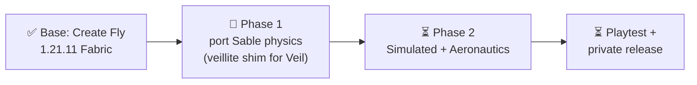

# minecraft-create-fly progress

_Last updated: 2026-10-17_

Port of Create Aeronautics to Minecraft 1.21.11 Fabric, on top of Create Fly 1.21.11-6.0.9-5. Task table in `ROADMAP.md`, porting rules in `PORTING.md`.

## Now
- Phase 1 finishing with 4 parallel agents (clones in `../mcf-agents/sable-*`, shared e2e lock): S11 Sodium, S17 compat mixins running. Open after: S12a Flywheel lighting, S10 manual checks (walk/jump on moving sub-levels, multiplayer).

## Next
- Phase 2: C1 (add `simulated`/`aeronautics` to the build) → C2 Registrate replacement.

## Done
- 2026-10-14: `:sable` compiles, server + client e2e pass, sub-levels render on 1.21.11.
- 2026-10-15: S9a closed as not a bug (the sphere lands before the first screenshot); `tools/e2e.sh` now exits non-zero when Gradle fails instead of reporting the previous run's log.
- 2026-10-17: S8a fixed: the server e2e force-loads the spawn area and logs loaded/moved sub-level counts (38/38 through 600 ticks).
- 2026-10-17: S14 fixed: Indigo path now re-shades rotated sub-levels (`getShade` neutral + up normal on shade-less quads); verified with a flipped platform, shading on vs off.
- 2026-10-17: S12 merged: Create Fly Flywheel visuals on sub-levels follow the sub-level pose (`tools/e2e.sh client flywheel`); lighting is S12a.
- 2026-10-17: S10 merged: `tools/e2e.sh playtest` checks assemble, fall/rest, stacking, standing on, carried by push/rotate/translate: 14/14 pass on integration.
- 2026-10-17: Phase 2 ported: Simulated + Aeronautics compile; server/client e2e pass, 22/22 GameTests, client `flight` scene flies an assembled airship.

## Blockers
- None. Note: this shell's `JAVA_HOME` is JDK 17 and the build needs 21; `e2e.sh` picks 21 itself; for Gradle use `JAVA_HOME=$(/usr/libexec/java_home -v 21)`.

## Decisions
- Keep the GitHub repo private. Why: ARR assets and the PolyForm Shield license on Sable.
- Push only when the merged state compiles.
- Cap concurrent Gradle builds at about 4. Why: 16 GB RAM with heavy swap.
- Never commit the `reference` symlink. Why: a merge that tracks it deletes the real ignored `reference/` folder (rebuild with `tools/setup-reference.sh`).
- Agents work in clones, not `isolation: worktree`, which attaches to the parent Projects repo.
- Parallel agents run e2e only through a shared lock (one game at a time). Why: 16 GB RAM.
