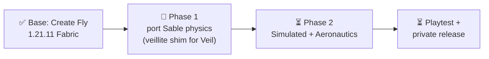

# minecraft-create-fly progress

_Last updated: 2026-10-15_

Port of Create Aeronautics to Minecraft 1.21.11 Fabric, on top of Create Fly 1.21.11-6.0.9-5. Task table in `ROADMAP.md`, porting rules in `PORTING.md`.

## Now
- Phase 1 runtime: server + client e2e pass. Open: S8a (server e2e loads no sub-levels), S10 manual playtest, S14 face shading of rotated sub-levels.

## Next
- Phase 2: C1 (add `simulated`/`aeronautics` to the build) → C2 Registrate replacement.

## Done
- 2026-10-14: `:sable` compiles, server + client e2e pass, sub-levels render on 1.21.11.
- 2026-10-15: S9a closed as not a bug (the sphere lands before the first screenshot); `tools/e2e.sh` now exits non-zero when Gradle fails instead of reporting the previous run's log.

## Blockers
- None. Note: this shell's `JAVA_HOME` is JDK 17 and the build needs 21; `e2e.sh` only picks 21 when `JAVA_HOME` is unset.

## Decisions
- Keep the GitHub repo private. Why: ARR assets and the PolyForm Shield license on Sable.
- Push only when the merged state compiles.
- Cap concurrent Gradle builds at about 4. Why: 16 GB RAM with heavy swap.
- Never commit the `reference` symlink. Why: a merge that tracks it deletes the real ignored `reference/` folder (rebuild with `tools/setup-reference.sh`).
- Agents work in clones, not `isolation: worktree`, which attaches to the parent Projects repo.
